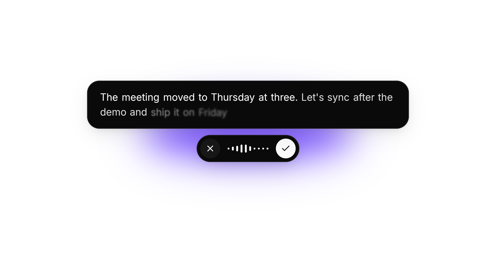

<div align="center">

# Tokativ

Local dictation for Linux, macOS and Windows. Press a key, talk, and the text is typed into the
focused app as you speak.

[](COPYING)
[](rust-toolchain.toml)
[](#install)
[](#install)
[](#install)

<picture>
  <source media="(prefers-color-scheme: dark)" srcset="docs/preview-dark.png">
  
</picture>
<br>
<br>

</div>

> [!NOTE]
> The project is vibe-coded as hell.

Speech is recognized on your machine by [transcribe.cpp](https://github.com/handy-computer/transcribe.cpp),
on the graphics card through Vulkan, or Metal on macOS, or on the CPU. Nothing is downloaded until
you pick a model: Parakeet is the recommended one, and settings can search Hugging Face for any
other GGUF model.

## Install

```sh
nix run github:nolight132/tokativ
```

With Home Manager, which also runs it as a user service:

```nix
imports = [ inputs.tokativ.homeModules.default ];
services.tokativ.enable = true;
```

On Linux both install the released binary; `nix run github:nolight132/tokativ#tokativ-source`
builds from source. On Apple silicon Macs, Nix builds from source and Home Manager runs it as a
launchd agent.

The [latest release](https://github.com/nolight132/tokativ/releases/latest) has x86_64 and ARM64
builds for all three platforms:

- **Windows:** run the `-setup.exe` installer for your architecture. A portable `.exe` is also available.
- **macOS:** download the `.app.tar.gz` for Intel or Apple silicon, extract it, and move Tokativ
  to Applications. Open it from the context menu on first launch; builds are not notarized.
- **Linux:** download the binary, make it executable, and put it on your `PATH` as `tokativ`.
  It needs glibc 2.35+, the Vulkan loader, Wayland, libxkbcommon and alsa-lib.

On Linux, Tokativ needs a compositor with layer shell, such as niri, Hyprland, Sway, river or KDE
Plasma. GNOME does not work. The first start opens a setup window that walks through the rest.

## Build from source

Install Rust through rustup (the checkout selects its version), CMake and a C++ toolchain:

- **Windows:** Visual Studio Build Tools with Desktop development with C++, a Windows SDK,
  NASM and the Vulkan SDK. Use Developer PowerShell; for ARM64, use clang-cl and Ninja.
- **macOS:** Xcode command line tools.
- **Linux:** pkg-config, glslc and development packages for Vulkan, SPIRV-Headers, Wayland,
  libxkbcommon, fontconfig, alsa-lib and OpenSSL. `nix develop` provides them.

```sh
git clone https://github.com/nolight132/tokativ.git
cd tokativ
cargo build --release --locked
```

Run `target/release/tokativ` (Windows: `.\target\release\tokativ.exe`).

## License

GPL-3.0-or-later.
