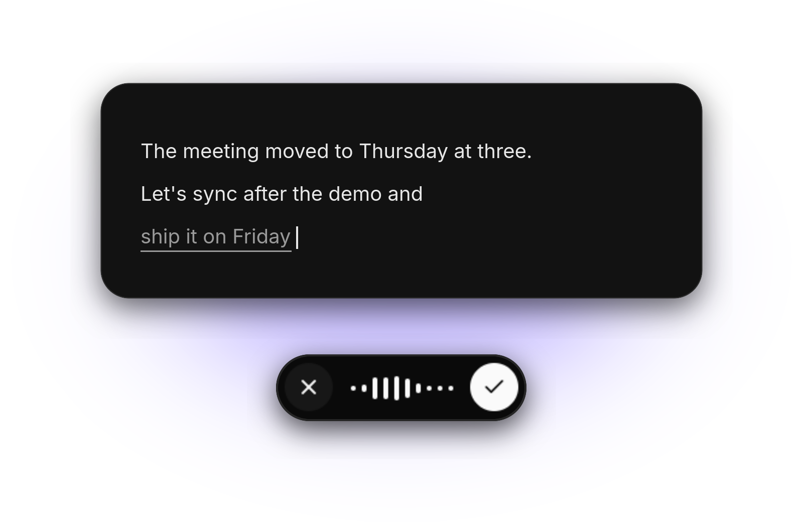

<div align="center">

# Tokativ

Local dictation for Wayland. Press a key, talk, and the text is typed into the focused app as you
speak.

[](COPYING)
[](rust-toolchain.toml)
[](#use)
[](#install)
[](#install)


<br>
<br>

</div>

> [!NOTE]
> The project is vibe-coded as hell.

Speech is recognized on your machine by [transcribe.cpp](https://github.com/handy-computer/transcribe.cpp),
on the graphics card through Vulkan or on the CPU. Nothing is downloaded until you pick a model:
Parakeet is the recommended one, and settings can search Hugging Face for any other GGUF model.

## Install

```sh
nix run github:nolight132/tokativ
```

With Home Manager, which also runs it as a user service:

```nix
imports = [ inputs.tokativ.homeModules.default ];
services.tokativ.enable = true;
```

Both install the binary from the latest [release](https://github.com/nolight132/tokativ/releases),
built for x86_64 and aarch64 against glibc 2.35. `nix run github:nolight132/tokativ#tokativ-source`
builds it from source instead. Without Nix, download the binary for your machine from the release
and put it on your `PATH` as `tokativ`. It needs the Vulkan loader, wayland, libxkbcommon and
alsa-lib.

From source you need Rust 1.98, a C++ compiler, cmake, pkg-config, glslc, and the development files
for Vulkan, SPIRV-Headers, wayland, libxkbcommon, fontconfig, alsa-lib and openssl. Then
`cargo build --release`.

## Use

Bind `tokativ toggle` to a key. The first press starts dictating, the second inserts the rest.
Enter finishes and Escape cancels. It needs a compositor with layer shell, so niri, Hyprland, Sway,
river or KDE Plasma, not GNOME.

## License

GPL-3.0-or-later.
